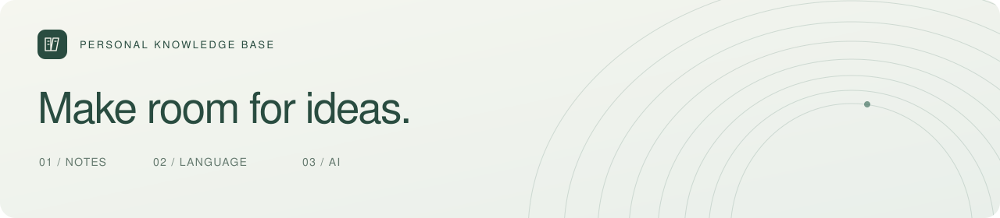
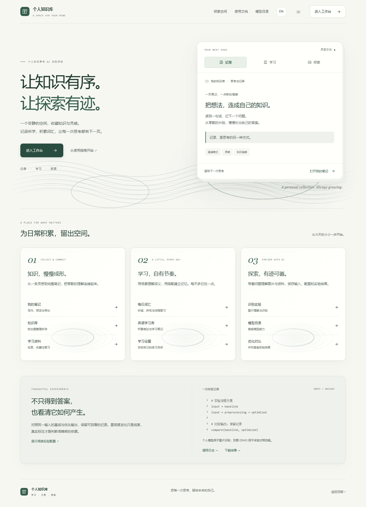

<p align="center">
  
</p>

<h1 align="center">个人知识库与 AI 识别评测</h1>
<p align="center">写下所学，记住新词，留住每一次探索。</p>
<p align="center">
  <a href="https://github.com/sunlight1106/Personal-Knowledge-Base-and-AI-Recognition-Evaluation/archive/refs/heads/main.zip"><strong>下载项目</strong></a>
  &nbsp; · &nbsp; <a href="docs/RELEASE_INSTALL.md">免编译安装</a>
  &nbsp; · &nbsp; <a href="#首次启动">开始使用</a>
  &nbsp; · &nbsp; <a href="docs/README.md">使用文档</a>
  &nbsp; · &nbsp; <a href="#常见问题">常见问题</a>
</p>

---

把笔记、词汇和学习资料放在同一个空间里。需要时，接入自己的 AI 分析图片、解释代码、整理思路；也可以与其他用户聊天、建群和分享资料。

群组支持成员管理、归档恢复、转让和解散；笔记删除后可以在回收站恢复，个人知识主题和卡片也可以继续编辑。具体入口见 [日常使用](docs/USAGE.md) 和 [群组管理](docs/GROUPS.md)。

发出的群组邀请与加入申请可以查看状态、撤回；站内信支持个人归档、回收站和批量已读。素材库可以查看空间占用与文件引用，删除前会检查文件是否仍在使用。

项目运行在你自己的电脑或服务器上。**普通笔记、背单词和交流不需要 AI 密钥；使用 Docker 部署，不需要另外安装 Java、Node.js 或 Maven。**

上传有大小、频率和病毒扫描检查；个人资料按账号隔离。页面增加了脚本加载限制，后台任务也有资源上限。部署前可查看 [安全设置](docs/SECURITY.md) 和 [备份恢复](docs/COMPOSE_BACKUP.md)。

<details>
<summary><strong>看看界面</strong> · 首页与工作入口</summary>



首页可以切换查看记录、学习和探索预览。「学习」里可先回忆搭配含义，再点击揭晓用法、换下一题，不需要登录。工作台、笔记、词汇、群组与管理页面使用统一的导航和纸面样式。

支持浅色、深色和四套主题配色，在「设置 → 外观」中切换。页头有缓慢流动的波纹，词书、侧栏和学习卡片带有局部涟漪，按钮点击也有水纹反馈。鼠标经过卡片时，光泽会随位置移动，经过水纹区域时波纹轻微偏移。顶部波纹按钮可随时暂停；系统启用减少动态效果时自动停用，编辑和阅读区域保持静止。

点击导航栏的 **EN / 中文** 可切换界面语言，也可以在「设置 → 外观 → 界面语言」中选择。首页、登录、文档和工作空间共用这个设置，当前浏览器会记住选择。切换不刷新页面，也不会翻译或改写你的笔记、消息、代码和学习资料。

下拉选择框跟随主题配色，当前选项旁有勾选标记。选项较多时，可以直接搜索；用键盘按 ↑ / ↓ 浏览、Enter 确认、Esc 取消。学习设置、笔记代码语言和个人 AI 配置都使用同一套菜单。

</details>

## 可以做什么

| | 日常操作 | 详细说明 |
| :--- | :--- | :--- |
| **笔记与知识库** | Markdown / HTML 边写边预览，分类整理、历史版本与回收站；导出 MD、PDF、Word、HTML、TXT | [笔记与资料整理](docs/LEARNING_WORKSPACE.md) |
| **代码可视化** | C / Python / Java / JavaScript 算法子集，变量与数组图、逐步回放、调用栈、执行计数与私人历史 | [运行一段代码](docs/CODE_LAB.md) |
| **背单词** | 场景、搭配和拼写练习，美音自动听读；跨词书接续进度，熟词 Skip，导入与备份 | [词书与学习](docs/VOCABULARY.md) |
| **AI 与图片理解** | 上传图片提问，解释代码，辅助笔记与词汇学习；配置自己的模型和共享记忆 | [个人 AI](docs/PERSONAL_AI.md) |
| **学习资料** | 导入 PDF / Word，本地识别扫描页、对照校对、划词听读与摘录；复习卡、表格、看板与月历 | [学习中心](docs/LEARNING_WORKSPACE.md) |
| **学习安排与后台任务** | 按每天可用时间分配任务，隔日检查薄弱项；后台导入、取消与重试 | [学习安排与阅读摘录](docs/STUDY_WORKFLOWS.md) |
| **学习统计与离线** | 每日与累计学习记录、七日回顾、管理员按用户查看；加密离线笔记与词汇练习 | [学习统计与离线使用](docs/LEARNING_STATISTICS.md) |
| **交流与协作** | 按唯一身份码找人，聊天、站内信、建群、发资料；公告、置顶与免打扰 | [群组与站内信](docs/GROUPS.md) |
| **账户与管理** | 邮箱验证、登录记录、双重验证；用户权限、统计折线图与举报审核 | [账户安全](docs/ACCOUNT_AND_RECOVERY.md) · [平台管理](docs/ADMINISTRATION.md) |

第一次登录，可以从 [新手分步指南](docs/USAGE.md#第一次使用先做一件小事) 开始：写一篇笔记、完成一次词汇练习、导入文档或制作复习卡。每一步都写明入口和完成后的结果。工作台「从这里开始」也能展开操作步骤；标题旁的圆形 **?** 提供简短说明，支持鼠标悬停、键盘聚焦和中英切换。

工作台的入门进度按账号显示已保存的记录，引导可以随时收起。资料多时，笔记、素材和站内信分批加载；学习中心支持本地关联搜索、保存搜索与失败任务筛选。具体用法见 [搜索、任务与运行状态](docs/DISCOVERY_AND_OPERATIONS.md)。

## 下载项目

**直接下载：** [下载 ZIP](https://github.com/sunlight1106/Personal-Knowledge-Base-and-AI-Recognition-Evaluation/archive/refs/heads/main.zip)，完整解压到固定目录，例如 `D:\KnowledgeAI`。确认目录里有 `compose.yaml`、`deploy.ps1` 和 `cle` 文件夹。

<details>
<summary>使用 Git 下载</summary>

```sh
git clone --depth 1 https://github.com/sunlight1106/Personal-Knowledge-Base-and-AI-Recognition-Evaluation.git
cd Personal-Knowledge-Base-and-AI-Recognition-Evaluation
```

</details>

## 首次启动

### 01 · 准备 Docker

Windows / macOS 安装并打开 [Docker Desktop](https://docs.docker.com/desktop/)，等待引擎就绪。Windows 使用 WSL 2 和 Linux 容器。Linux 安装 Docker Engine 和 Compose 插件。

Compose 至少为 **2.20.2**，建议给 Docker 分配 **8 GB 内存**。首次安装需要联网下载镜像、依赖和病毒库，比日常启动慢。当前对象存储使用 `linux/amd64`，ARM 电脑需要相应仿真支持。

已有完整 Release 时，也可使用 [预构建安装包](docs/RELEASE_INSTALL.md)，省去本机编译。需要安装 Python；仍需联网下载镜像。没有完整附件的版本继续按下面的源码方式安装。

### 02 · 在项目目录启动

**Windows** — 打开解压后的项目文件夹，在地址栏输入 `powershell` 并回车，粘贴运行：

```powershell
powershell -NoProfile -ExecutionPolicy Bypass -File .\deploy.ps1
```

**Linux / macOS** — 在项目目录打开终端，运行：

```sh
sh deploy.sh
```

脚本会生成配置、构建镜像并等待服务就绪。看到 **`Ready: http://localhost:4173`** 后，在浏览器打开这个地址；如果调整过端口，以实际输出为准。

### 03 · 登录自己的空间

| 登录信息 | 去哪里找 |
| :--- | :--- |
| 管理员用户名 | 默认 `admin`；修改过则查看 `.env` 的 `BOOTSTRAP_ADMIN_USERNAME` |
| 管理员初始密码 | 用文本编辑器打开项目根目录的 `.env`，查看 `BOOTSTRAP_ADMIN_PASSWORD=` 后面的内容 |
| 普通用户 | 在登录页点击「注册」，或由管理员创建账号 |

登录后可在个人设置中修改密码。已有安装继续使用原来的密码。

> **保管好 `.env`。** 它包含密码和加密密钥，不要上传到 GitHub，也不要用 `.env.example` 覆盖。恢复已有数据时需要原配置。

<details>
<summary>4173 端口被占用，怎么换一个？</summary>

首次部署可指定端口：

```powershell
powershell -NoProfile -ExecutionPolicy Bypass -File .\deploy.ps1 -Port 4273
```

如果已经生成 `.env`，先修改其中的 `WEB_PORT`，再更新前端容器以应用新端口：

```sh
docker compose up -d --no-deps frontend
```

</details>

## 日常使用

右上角的 **「目录与账户」** 是所有功能的入口，也可以在这里切换账号或退出。

1. **先写一篇笔记。** 打开「我的笔记」，选择学习库，新建内容；左边编写，右边预览。
2. **开始一次背词。** 打开「背单词 → 我的词书」，选一本再开始学习。换词书后，同一个单词沿用之前的进度。
3. **需要 AI 时再配置。** 打开「设置 → 个人 AI」，填写自己的供应商、模型和密钥。调用前先预览发送内容，再确认；部署者需要开启远程调用。
4. **调成习惯的样子。** 在「设置 → 外观」选择鼠尾草、玫瑰、雾蓝或鸢尾；常用页面可在「目录与账户」点 **＋** 固定到顶部，最多 5 个。

工作台可继续最近的笔记、词书和实验。更多操作见 [日常使用指南](docs/USAGE.md)，全部说明见 [文档目录](docs/README.md)。

### 再次启动与停止

| 操作 | 方法 |
| :--- | :--- |
| Windows 再次启动 | 双击项目目录里的 **`start.cmd`** |
| Linux / macOS 再次启动 | 在项目目录执行 **`sh deploy.sh`** |
| 停止并保留数据 | 在项目目录执行 **`docker compose stop`** |

日常启动会复用已有容器和镜像。Windows 安装了 Python 时会打开启动进度页，没有 Python 也能从终端启动。启动异常或想了解耗时，查看 [启动与排查](docs/STARTUP.md)。

训练服务按需启动，Windows 使用 `deploy.ps1 -Training`，Linux / macOS 使用 `COMPOSE_PROFILES=training sh deploy.sh`。基础页面先就绪，文件上传仍须等待存储与病毒扫描可用。长期监控、在线快照和恢复演练见 [部署维护](docs/OPERATIONS_UPGRADE.md)。

> 普通停止和更新不要使用 `docker compose down -v`，它会删除数据卷。

## 更新版本

**先备份，再更新源码，最后构建新版。** 只运行 `start.cmd` 不会安装新代码。使用预构建包的用户按 [镜像更新步骤](docs/RELEASE_INSTALL.md#更新已有安装) 操作，安装器会先完成加密备份和校验。

Git 下载的用户，在原项目目录运行：

```sh
git pull --ff-only
```

ZIP 下载的用户：下载最新 ZIP 到临时目录，停止原项目，将新版源码覆盖到原项目目录，保留原 `.env` 和本地数据文件。

然后选择对应系统的命令：

```powershell
# Windows
powershell -NoProfile -ExecutionPolicy Bypass -File .\deploy.ps1 -Build
```

```sh
# Linux / macOS
sh deploy.sh --build
```

数据库迁移随新版后端启动执行，原数据和 `.env` 保留。如果修改了数据库、缓存或存储组件的 Compose 配置，使用 `-FullBuild` / `--full-build`。多个源码目录默认连接同一组 Compose 服务，不代表多个独立环境。

<details>
<summary>之前下载过旧名称的仓库</summary>

在原项目目录更新一次远程地址即可，本地文件夹不必改名：

```sh
git remote set-url origin https://github.com/sunlight1106/Personal-Knowledge-Base-and-AI-Recognition-Evaluation.git
```

</details>

## 备份与部署

笔记和账户保存在 **MySQL**，上传资料放在 **MinIO**；实际运行数据使用 Docker 命名卷。仓库的 `database` 目录保存结构和词库，不是当前用户的数据库。

| 你想做什么 | 从这里开始 |
| :--- | :--- |
| 备份整个网站，或迁移到新电脑 | [完整备份与恢复](docs/COMPOSE_BACKUP.md) — 保留数据库、文件和原 `.env` |
| 定时备份 | [每日备份设置](docs/ACCOUNT_AND_RECOVERY.md#windows-每日自动备份) |
| 保存词书和学习进度 | 「背单词」的备份入口；同一账号恢复时自动合并 |
| 下载自己的资料 | 「设置 → 隐私与数据」，确认密码后导出 |
| 让其他人联网使用 | [服务器、域名与 HTTPS 部署](docs/PUBLIC_DEPLOYMENT.md) |

默认只监听本机 `127.0.0.1:4173`。各自在电脑上启动的站点不会互通账号；多人使用需要连接同一个服务器和域名。公网访问、SMTP 邮件和异地备份需要另外配置。

## 常见问题

<details>
<summary><strong>网页打不开，或启动一直没完成</strong></summary>

先确认 Docker Desktop 的 Linux 引擎已就绪，使用脚本输出的 `Ready` 地址。在项目目录查看状态：

```sh
docker compose ps
docker compose logs --tail 100 clamav backend
```

首次安装需要下载和构建，病毒库也可能仍在下载。更多情况见 [启动排查](docs/STARTUP.md)。

</details>

<details>
<summary><strong>忘记管理员初始密码，或登录提示 500</strong></summary>

初始密码在本机 `.env` 的 `BOOTSTRAP_ADMIN_PASSWORD` 中。改过密码的已有账号使用新密码；权限变动后需要重新登录。

如果提示 500，在项目目录运行 `docker compose logs --tail 100 backend` 查看错误。排查时提供错误码或 traceId 即可，不要公开 `.env`、密码或密钥。

</details>

<details>
<summary><strong>AI 无法发送，或者邮箱收不到验证邮件</strong></summary>

- AI：检查个人配置是否保存并启用，以及部署端是否开启远程调用。见 [个人 AI 配置](docs/PERSONAL_AI.md)。
- 邮箱：需要部署者配置 SMTP。见 [邮箱验证与找回密码](docs/ACCOUNT_AND_RECOVERY.md)。

没有 AI 密钥仍可写普通笔记、背单词和交流。

</details>

<details>
<summary><strong>用户看不到某个功能，或已读后仍有待处理事项</strong></summary>

功能入口取决于角色和个人权限，「单独禁止」覆盖角色允许，由管理员在用户管理中调整。权限由后端逐次检查；群组身份不能绕过平台禁用。笔记、AI 记忆和私人站内信按归属隔离，管理员可处理举报证据，但不能直接打开别人的上述私有内容。

通知角标只计算未读消息。联系人申请、群邀请、到期复习和备份告警属于待处理事项，处理完成前会保留，但不计入角标。详见 [通知与已读](docs/USAGE.md#通知与已读)。

</details>

<details>
<summary><strong>更新后还是旧页面</strong></summary>

确认执行了 `-Build` / `--build` 更新，等待服务就绪后按 **Ctrl + F5** 刷新浏览器。日常启动只启动现有版本。

</details>

### AI 功能的当前范围

图片理解使用用户配置的视觉模型。实验台 DEMO 用于体验流程，真实视频模型调用尚未开放。本地训练目前提供 **PyTorch CPU 文本分类器**；代码分析由 AI 静态推断，不会在服务器执行笔记里的代码。使用前可查看 [配置与训练说明](docs/PERSONAL_AI.md)。

## 开发与验证

<details>
<summary><strong>源码结构与本地检查命令</strong></summary>

| 目录 | 内容 |
| :--- | :--- |
| `cle/` | Vue 客户端 |
| `src/` | Spring Boot 后端 |
| `ai/` | 模型适配、媒体处理和训练 |
| `database/migrations/` | 数据库迁移 |
| `scripts/` | 启动、备份与运行维护 |
| `docs/` | 使用和部署文档 |

开发需要 Node.js **22.22.2+（22.x）**、JDK **17** 和 FFmpeg。只启动前端无法完成登录，还需要数据库等服务。组件关系见 [部署结构](docs/STACK.md)。

```sh
npm ci --prefix cle
npm run test:unit --prefix cle
npm run test:ui --prefix cle
npm run build --prefix cle
```

后端测试：Windows 运行 `.\mvnw.cmd -B verify`，Linux / macOS 运行 `./mvnw -B verify`。H2 仅用于测试，MySQL 检查见 [数据库说明](database/README.md)。

自动交互检查使用模拟资料，不发送真实消息或收费 AI 请求。完整范围和复跑方法见 [功能验收](docs/FUNCTIONAL_TESTS.md)，实际执行结果见 [验证记录](docs/VALIDATION.md)。

</details>

[自动构建](https://github.com/sunlight1106/Personal-Knowledge-Base-and-AI-Recognition-Evaluation/actions) · [权限检查](docs/PERMISSION_TESTS.md) · [交互检查](docs/INTERACTION_CHECKS.md) · [安全说明](docs/SECURITY.md)

## 许可

项目代码使用 [MIT License](LICENSE)。依赖许可见 [THIRD_PARTY_NOTICES.md](THIRD_PARTY_NOTICES.md)，自行上传的内容按其许可使用。
